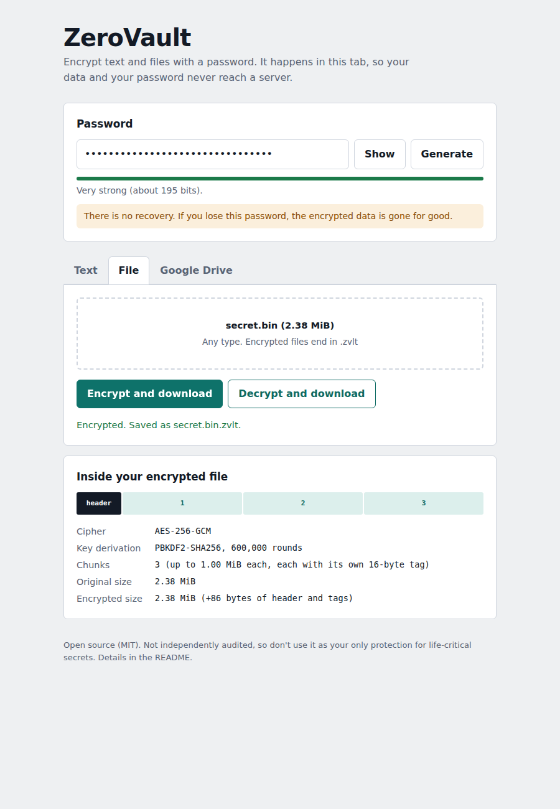

# ZeroVault

Encrypt text and files with a password, entirely in your browser, and optionally store the encrypted result in Google Drive. No server, no accounts, no dependencies, no build step.



## Features

- **Text and file encryption** with AES-256-GCM, using the browser's built-in Web Crypto API.
- **Zero-knowledge by design.** Encryption and decryption run in your tab. Your password and plaintext are never sent anywhere.
- **Tamper detection.** Any modified, reordered or truncated file fails to decrypt instead of returning corrupted data.
- **Large files.** Data is processed in 1 MiB chunks, so big files don't have to fit in memory at once.
- **Google Drive integration.** Encrypt and upload, then download and decrypt, using the narrow `drive.file` permission (the app can only see files it created).
- **Password helpers.** Strength meter and a secure random password generator.
- **Pluggable storage.** Cloud services sit behind a small interface, so adding Mega, Dropbox or OneDrive means writing one file.
- **Zero runtime dependencies.** Plain HTML, CSS and ES modules. Nothing is downloaded to run it, and Google's sign-in script is only fetched if you open the Drive tab.
- **Verifiable.** A `SHA256SUMS` file lets you check that your copy of the code is unmodified.

## Quick start

You need Node.js 20+ (for the tests and the local server) and a modern browser.

```bash
git clone <this-repo-url>
cd zerovault
npm test        # runs the test suite (no install step needed)
npm run verify  # checks your files against SHA256SUMS
npm start       # serves the app at http://localhost:8080
```

`npm start` runs a tiny built-in server (`scripts/serve.js`) that uses only Node's standard library, so nothing is downloaded. It listens on `127.0.0.1` only. Any static server works too, for example `python3 -m http.server 8080`. The app must be served from `localhost` or `https://` because the Web Crypto API only works in a secure context, so opening `index.html` directly from disk will not work.

## How it works

```
  password ──► PBKDF2-SHA256 (600,000 rounds, random salt) ──► 256-bit key
                                                                    │
  file ──► split into 1 MiB chunks ──► AES-256-GCM per chunk ◄──────┘
                                              │
                          [38-byte header][chunk 0 + tag][chunk 1 + tag]...  = .zvlt file
```

| Decision | Why |
|---|---|
| **AES-256-GCM** | Authenticated encryption: it hides the data *and* detects any change to it. Standard, fast, and built into every browser. |
| **PBKDF2-SHA256, 600,000 rounds** | A password is not a key. Stretching it makes each password guess expensive for an attacker. 600,000 is the OWASP 2023 recommendation for this function. |
| **Random salt per file** | The same password gives a different key for every file, so attackers can't reuse precomputed tables. |
| **Chunked encryption** | Lets large files stream through in small pieces. Each chunk gets a unique IV (8 random bytes + chunk counter). |
| **Header, chunk number and "final" flag bound into every chunk** | Stops header edits, chunk reordering and silent truncation (see [docs/FILE_FORMAT.md](docs/FILE_FORMAT.md)). |
| **Non-extractable key** | The derived key can be used by the browser but its bytes can never be read by JavaScript. |
| **Built-in Web Crypto, no libraries** | No third-party crypto code to trust, update or audit. |
| **Content Security Policy** | The page can only talk to itself and Google, so an injected script couldn't send your data elsewhere. |

## Trust model: where does the JavaScript come from?

Browser-based encryption has one well-known catch: **whoever serves the JavaScript could serve a modified copy** (for example one that sends your password somewhere). Encryption that runs in your tab is only as trustworthy as the code your tab was given.

ZeroVault deals with this in the following ways:

- **It is not hosted anywhere.** The recommended way to use it is to clone the repo and run it locally, so the code you read is the code that runs. There is no build step and no bundled third-party code.
- **You can verify your copy.** `npm run verify` compares every file the browser loads against `SHA256SUMS`. Compare that file against the one in a release you trust. (`src/config.js` is excluded because you edit it with your own Google client ID.)
- **No third-party code on the password page by default.** Google's sign-in script is loaded only after you open the Drive tab, and only if you configured a client ID.
- **A strict Content Security Policy** limits which origins the page may load code from or send data to.
- **If you host it yourself,** use HTTPS, pin it to a tagged release, publish the checksums with the release, and don't load anything from a CDN.

What this does *not* solve: if you use a copy hosted by someone else, you are trusting them. That limitation applies to every web-based encryption tool, which is why running it locally is the stronger option.

## What it protects against (and what it doesn't)

**Protects against**
- Someone getting your encrypted file or text (stolen laptop, leaked backup, curious cloud provider). Without the password they have unreadable bytes.
- Silent tampering: modified, reordered or truncated files are rejected.
- Brute-force guessing of a strong password (each guess costs 600,000 hash rounds).

**Does not protect against**
- **A weak password.** This is the real weak point of any password-based encryption. Use the generator, or a passphrase of 4-5 random words.
- **A forgotten password.** There is no recovery by design. Nobody, including you, can decrypt without it.
- **Malware or a malicious browser extension** on your device, which can read your screen and keystrokes before encryption happens.
- **Metadata.** File size (roughly) and upload time are visible to the storage provider. File names are *not* encrypted: the app stores `<name>.zvlt` in Drive, so pick names that don't reveal anything.
- **A compromised copy of this site.** If you host it, serve it over HTTPS and only from a source you control.

> "Unbreakable" is not a real thing in cryptography. AES-256 itself is not known to be breakable; what breaks real systems is bad passwords, bad implementations and compromised devices. This project sticks to standard algorithms and standard APIs, but it has **not** had an independent security audit.

## Project structure

```
zerovault/
├── index.html               Page markup + Content Security Policy
├── SHA256SUMS               Fingerprints of every file the browser loads
├── scripts/
│   ├── serve.js             Zero-dependency local server (127.0.0.1 only)
│   └── manifest.js          Writes / verifies SHA256SUMS
├── src/
│   ├── config.js            Your Google OAuth client ID goes here
│   ├── styles.css
│   ├── crypto/              The security-critical layer (no DOM code)
│   │   ├── constants.js       All sizes/limits, with the reason for each
│   │   ├── bytes.js           Big-endian ints, concat, random bytes, base64
│   │   ├── kdf.js             Password -> AES key (PBKDF2)
│   │   ├── format.js          Reads/writes/validates the 38-byte header
│   │   ├── cipher.js          Chunked AES-GCM encrypt/decrypt (the core)
│   │   ├── text.js            String <-> base64 wrapper over cipher.js
│   │   ├── strength.js        Password strength estimate
│   │   ├── generator.js       Secure random password generator
│   │   ├── errors.js          FormatError, DecryptionError
│   │   └── index.js           Public API of the layer
│   ├── cloud/
│   │   ├── provider.js        The interface every storage backend implements
│   │   └── googleDrive.js     Google Drive implementation
│   └── ui/
│       └── app.js             Connects the page to the layers above
├── tests/                   Node's built-in test runner
├── docs/FILE_FORMAT.md      Byte-level spec of the .zvlt format
└── .github/workflows/       CI: runs the tests on every push
```

The design rule: **`src/crypto/` knows nothing about the page or the cloud, and the cloud providers never see plaintext or passwords.** That keeps the sensitive code small, testable in plain Node, and easy to review.

## Code walkthrough

### 1. Turning a password into a key (`kdf.js`)

```js
const material = await crypto.subtle.importKey('raw', encoder.encode(password.normalize('NFKC')),
                                               'PBKDF2', false, ['deriveKey']);
return crypto.subtle.deriveKey(
  { name: 'PBKDF2', salt, iterations, hash: 'SHA-256' },
  material,
  { name: 'AES-GCM', length: 256 },
  false,                       // non-extractable
  ['encrypt', 'decrypt'],
);
```

The password is first wrapped as PBKDF2 "key material", then stretched with the random salt into a 256-bit AES key. `normalize('NFKC')` makes visually identical Unicode passwords produce the same key.

### 2. Encrypting a file (`cipher.js`)

```js
const salt = randomBytes(16);           // new for every file
const ivPrefix = randomBytes(8);        // new for every file
const header = encodeHeader({ iterations, chunkSize, salt, ivPrefix });
const key = await deriveKey(password, salt, iterations);

for (let index = 0; index < chunkCount; index++) {
  const plain = await input.slice(start, start + chunkSize).arrayBuffer();
  const isFinal = index === chunkCount - 1;
  const cipher = await crypto.subtle.encrypt(
    { name: 'AES-GCM',
      iv: buildIv(ivPrefix, index),                    // 8 random bytes + 4-byte counter
      additionalData: buildAad(header, index, isFinal) // header + index + final flag
    }, key, plain);
  parts.push(new Uint8Array(cipher));                  // ciphertext + 16-byte tag
}
```

Three things make this safe:
1. **The IV is never reused.** GCM is catastrophically insecure if a key and IV repeat. The chunk counter makes IVs unique inside a file, and the random salt makes the key unique per file.
2. **The AAD (additional authenticated data) is not stored.** Encryptor and decryptor each rebuild it. If anything differs (a changed header, a swapped chunk, a removed last chunk), the authentication tag no longer matches and decryption throws.
3. **An empty file still produces one chunk**, so there is always a final, authenticated chunk to check.

### 3. Decrypting (`cipher.js`)

Decryption validates the header first (never trust a file's own claims: iteration counts and chunk sizes are range-checked, so a malicious file can't make your tab compute for hours). It then works out the chunk layout from the file size, derives the key, and decrypts chunk by chunk. A failure surfaces as `DecryptionError`, because GCM cannot tell a wrong password from tampering, and the UI says exactly that.

### 4. Text (`text.js`)

Text uses the same format as files. The only extra step is base64, so the output is a string you can paste into a message.

### 5. The storage interface (`cloud/provider.js`)

```js
isConfigured()  isConnected()  connect()  disconnect()
upload(name, blob)  list()  download(file)  remove(file)
```

`ui/app.js` only ever calls these. Encryption happens before `upload` and decryption after `download`, so a provider is physically unable to see your data.

### 6. Google Drive (`cloud/googleDrive.js`)

- **Loading:** Google's sign-in script is not in `index.html`. `loadGoogleScript()` adds it to the page only after you open the Drive tab (and only if a client ID is set), so no third-party code runs next to the password box otherwise.
- **Sign-in:** Google Identity Services opens a consent popup and hands back a short-lived access token (about one hour). No backend and no client secret are involved. The token lives in memory only, so closing the tab signs you out.
- **Scope:** `drive.file`, which lets the app see only files it created.
- **Upload:** a single multipart request carrying the file name (JSON) and the encrypted bytes.
- **List/download/delete:** plain calls to the Drive REST API through `fetch`.

### 7. The UI (`ui/app.js`)

Contains no cryptography. It reads inputs, calls the layers above, disables buttons while work is in progress (so two operations can't overlap), shows progress and errors, and renders the "Inside your encrypted file" panel. File names from Drive are inserted with `textContent`, never `innerHTML`, so a hostile file name can't inject HTML.

## Enable Google Drive

The text and file tabs work with no setup. For Drive you need your own free OAuth client ID (Google's console labels change occasionally, but the flow is the same):

1. Open the [Google Cloud Console](https://console.cloud.google.com/) and create a project.
2. **APIs & Services → Library:** search for **Google Drive API** and enable it.
3. **OAuth consent screen** (now under *Google Auth Platform*): choose **External**, fill in the app name and your email, add the scope `.../auth/drive.file`, and add your own Google account under **Test users**.
4. **Credentials → Create credentials → OAuth client ID → Web application.** Under **Authorized JavaScript origins**, add `http://localhost:8080` (and your own domain if you host it).
5. Copy the client ID into `src/config.js`:
   ```js
   export const GOOGLE_CLIENT_ID = '1234-abcd.apps.googleusercontent.com';
   ```
6. Run `npm start`, open the **Google Drive** tab, and click **Connect**.

While the consent screen is in "Testing" mode, only the test users you listed can sign in, and Google shows an "unverified app" warning. That's fine for personal use and demos. A client ID is not a secret, so committing it is normal; never add a client *secret* (this app doesn't use one).

## Adding another storage provider (for example Mega)

1. Create `src/cloud/mega.js` exporting a class that implements the methods in `provider.js`.
2. In `ui/app.js`, instantiate it next to `GoogleDriveProvider`.
3. Add a tab for it, or turn the Drive tab into a provider picker.

Nothing in `src/crypto/` changes. Mega's own SDK (`megajs`) would need a bundler or an ES-module CDN import plus a CSP update, which is why it is left as a roadmap item and not shipped here.

## Tests

```bash
npm test
```

The suite uses Node's built-in test runner (no installs). It covers:

- Round trips for text, binary files spanning many chunks, exact-multiple sizes and empty files.
- Wrong password rejected.
- Same input and password never produce the same output (random salt and IV).
- A single flipped bit in the ciphertext is detected.
- Header edits, chunk reordering and **truncation at a chunk boundary** are detected.
- Non-ZeroVault input gives a clear `FormatError`, and an absurd iteration count in a header is refused.
- Password strength scoring and generator output.
- `SHA256SUMS` matches the files on disk, so the checksum list can't go stale.

Tests use a low iteration count (1,000) for speed. The app itself always uses 600,000. After changing any app file, run `npm run manifest` to refresh `SHA256SUMS`.

## Limitations and roadmap

- **Not audited.** Treat it as a well-built learning and portfolio project, not a replacement for audited tools such as age, VeraCrypt or Cryptomator.
- PBKDF2 is memory-light. **Argon2id** would resist GPU cracking better but needs a WebAssembly library. The header's KDF id field already allows adding it without breaking old files.
- File names aren't encrypted. A future version could store the original name inside the encrypted payload.
- Whole files are read through `Blob.slice()` and the output is collected as a Blob. For multi-GB files, streaming straight to disk (File System Access API) would be better.
- Mega, Dropbox and OneDrive providers.
- Optional key files or two-factor unlock in addition to the password.

## License

MIT. See [LICENSE](LICENSE).
